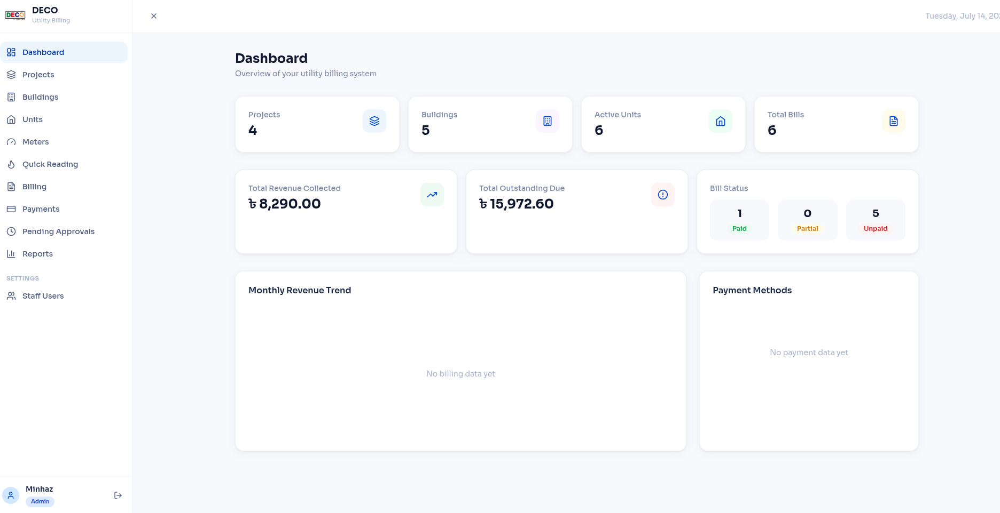
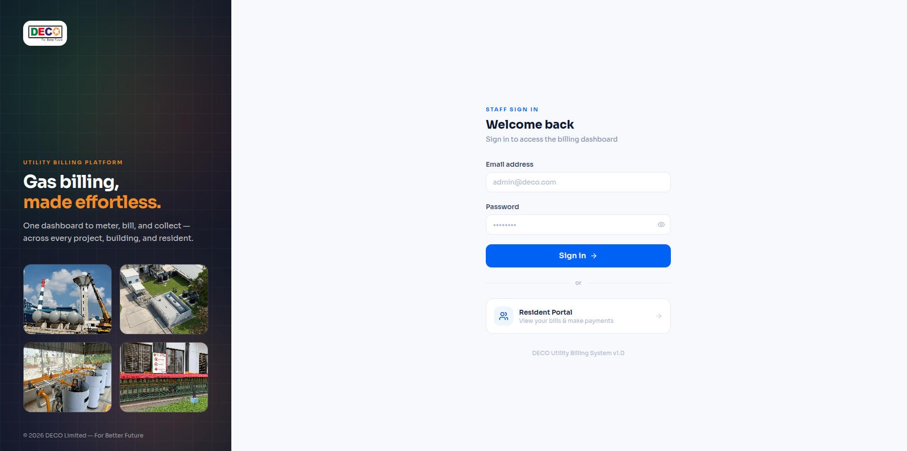
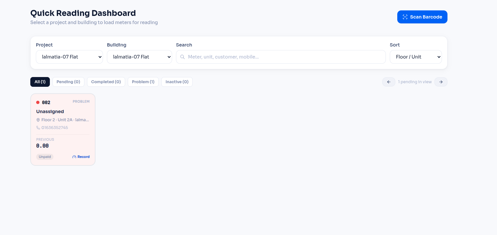

# 🔥 DECO — Utility Billing System

A full-stack DECO Utility Billing Management System built with **Django REST Framework** (backend) and **React + Vite + TypeScript** (frontend), with a Tailwind CSS UI. It has two front doors: a **staff app** (`/staff/...`) for billing, meters, payments and administration, and a **Resident Portal** (`/portal/...`, also the site root) where residents view bills and pay.

---
## 📸 System Images

<p align="center">
  
</p>

<p align="center">
  
  &nbsp;&nbsp;&nbsp;
  
</p>


## 📁 Project Structure

```
gas-billing-system/
├── backend/                      # Django REST API
│   ├── gas_billing/               # Django project settings, urls, celery app
│   ├── core/                      # Cross-app shared code
│   │   ├── permissions.py         # All RBAC permission classes (single source of truth)
│   │   ├── rbac.py                # Per-role default module permissions
│   │   ├── pagination.py          # StandardPagination (20/page, up to 1000) + LargePagination
│   │   ├── image_utils.py
│   │   └── exceptions.py
│   ├── apps/
│   │   ├── authentication/        # Staff login (JWT), Customer login (password + OTP), Roles, per-user overrides
│   │   ├── projects/               # Projects & Pricing Packages (m³→Kg ratio); Project.manager_unit
│   │   ├── buildings/              # Buildings under projects
│   │   ├── units/                  # Units, Floors, Allottees, bulk import (meter assigned from here)
│   │   ├── meters/                 # Meters, readings, Quick Reading Dashboard, barcode lookup
│   │   ├── billing/                # Bill creation, spreadsheet edit, bulk creation, deletion rules
│   │   ├── payments/                # Payments, approval workflow, bKash checkout, channel settings
│   │   ├── reports/                 # Revenue analytics + Excel/PDF export endpoints
│   │   │   └── exports/             # openpyxl / reportlab builders (bills, payments, building workbook)
│   │   ├── messaging/               # SMS: automatic bill/reminder messages, notices, templates, history
│   │   ├── portal/                  # Resident Portal API, notifications, invoice PDF, manager view
│   │   ├── backups/                 # Database/media backups (Super Admin)
│   │   └── audit/                   # Full audit trail (staff- and customer-attributed)
│   ├── Dockerfile
│   ├── requirements.txt
│   └── manage.py
│
├── frontend/                      # React 18 + TypeScript + Vite
│   ├── src/
│   │   ├── api/                    # Axios clients — staff (client.ts), resident portal (portalClient.ts),
│   │   │                             messaging (messagingClient.ts); each with its own JWT handling
│   │   ├── components/
│   │   │   ├── layout/              # AppLayout (staff), PortalLayout (resident)
│   │   │   ├── ui/                  # Modal (focus trap, scroll lock, Esc), Pagination, Badge, Spinner,
│   │   │   │                          ConfirmDialog, AccessDenied, etc.
│   │   │   ├── forms/               # FormField, TextInput, SearchInput, …
│   │   │   ├── meters/              # MeterCard, ReadingModal, BarcodeScanner, MeterAssignModal
│   │   │   ├── payments/            # PaymentModal, PaymentChannelsCard
│   │   │   └── pwa/                 # Install / update prompt
│   │   ├── pages/
│   │   │   ├── auth/                 # Staff login
│   │   │   ├── dashboard/
│   │   │   ├── projects/             # Projects & Packages
│   │   │   ├── buildings/
│   │   │   ├── units/                 # Units, allottees, meter assignment, project manager unit
│   │   │   ├── meters/                # Meters + Quick Reading Dashboard
│   │   │   ├── billing/               # List / Spreadsheet / Bulk-create / Export / Detail
│   │   │   ├── payments/              # Payments list, Pending Approvals queue
│   │   │   ├── messaging/             # Send Notice, History, Templates, Settings
│   │   │   ├── reports/
│   │   │   ├── audit/                 # Audit logs (Super Admin)
│   │   │   ├── settings/              # Staff, Roles & RBAC, Payment Channels, Backups
│   │   │   └── portal/                # Dashboard, Bills, Payments, Profile, Project (managers), unit picker
│   │   ├── hooks/                     # usePermissions, useConfirm, useDebounce, usePersistedState
│   │   ├── store/                     # Zustand: separate staff and customer auth stores
│   │   └── utils/
│   ├── Dockerfile
│   ├── nginx.conf
│   └── package.json
│
├── deploy/                        # systemd units for Celery worker and beat
├── docs/
│   └── schema.sql                # Full PostgreSQL schema reference
├── scripts/
│   └── setup.sh                  # One-command setup script
└── docker-compose.yml            # Full stack Docker setup
```

---

## 🚀 Quick Start

### Option A — Local Development

```bash
# 1. Setup everything at once
chmod +x scripts/setup.sh && ./scripts/setup.sh

# 2a. Start backend
cd backend
source venv/bin/activate
python manage.py migrate
python manage.py runserver

# 2b. Start frontend (new terminal)
cd frontend
npm install
npm run dev
```

### Option B — Docker Compose

```bash
cp backend/.env.example backend/.env   # Edit secrets
docker compose up --build
```

**Access:**
- 🌐 Frontend: http://localhost:5173 — Resident Portal at `/`, staff app at `/staff/login`
- 🔌 API: http://localhost:8000/api/v1/
- 🔑 Default admin: `admin@gasbill.com` / `Admin@1234` (**development only** — changed before the shared or production deployment)

---

## 🌟 Features

### Core Billing
- ✅ Multi-project, multi-building, multi-unit billing hierarchy
- ✅ Gas bill creation with m³ meter readings; bills on Kg when a package defines a conversion ratio
- ✅ Automatic server-side bill calculation (usage × unit price + charges − discounts) — never trusts client-submitted totals
- ✅ Optional percentage charge (e.g. bKash fee) applied on a bill's base amount
- ✅ Bill adjustments with mandatory audit reason (Billing Officer)
- ✅ Partial payments — bills auto-update to Partial/Paid status
- ✅ **Automatic Billing from Package** — a unit's package, else its building's, else its project's default fills unit price, service charge and conversion ratio
- ✅ **Spreadsheet Billing** — inline-editable list view (Super Admin/Admin) with per-field dirty-state, live totals, per-row save
- ✅ **Bulk Bill Creation** — bills for every active unit in a building, from already-recorded meter readings. Units already billed, without a reading, or with **zero usage** are skipped and reported by name
- ✅ **Bill deletion rules** (Super Admin only) — blocked while a bill has payment records, a completed bKash transaction, or a bKash checkout started within the last hour; failed/abandoned bKash attempts are removed with the bill and recorded in the audit log

### Meter Reading
- ✅ **Quick Reading Dashboard** — meter cards per building, colour-coded by status (Pending/Completed/Problem/Inactive), auto-advance to the next pending meter, and sorting by floor/unit, meter no., allottee, status or previous reading (ascending/descending)
- ✅ **Barcode / QR scan-to-select** — camera scan resolves directly to a meter and pre-fills the reading form
- ✅ Meter assignment lives on the Units page (assign or edit in one action)

### Payments
- ✅ Cash, Bank Transfer, bKash, Card, SSLCommerz methods
- ✅ **bKash Tokenized Checkout** — started by a resident from the portal or by staff for a walk-in; the result is verified server-side and auto-approved. If bKash is unreachable, the manual flow below still works
- ✅ **Customer Portal Payment** — proof-based submission (screenshot/invoice), held as Pending until reviewed; does not touch the bill balance until approved
- ✅ **Accountant Payment Approval Queue** — Approve (atomically applies to the bill) or Reject (with required remarks)
- ✅ **Manual Payment Entry** — staff-recorded payments require proof + transaction ID, auto-approved
- ✅ **Payment Channel Settings** — Super Admin-configurable bKash/Nagad/Bank details shown to customers before they pay
- ✅ Live "Previous Paid / Previous Due / Remaining Due" calculation while entering a payment, over-payment blocked
- ✅ Transaction ID tracking; atomic payment application (DB transaction)

### Resident Portal
- ✅ Login by mobile + password (initial password = the mobile number; changeable via OTP) or mobile + OTP; staff can reset a resident's password from the Unit form, no OTP
- ✅ One mobile number can own several flats — a unit picker after login and a unit switcher in the header
- ✅ Dashboard (due / paid / usage trend), bill list and detail, **invoice PDF download**, payment history, profile
- ✅ In-app notifications: new-bill alerts and day-5/day-10 payment reminders
- ✅ **Project manager unit** — see below
- ✅ Installable (PWA prompt)

### Project Manager Unit
- ✅ Each project can have **one manager unit**. Admin / Super Admin assign it from **Units → Edit unit → "Project manager unit"**; the unit shows a *Project manager* badge. The unit must be Active and have a mobile number
- ✅ The resident of that unit gets a read-only **Project** tab in the portal: billed / collected / due totals and collection rate for a chosen month, Paid / Partial / Unpaid counts (clickable filters), a per-building breakdown, and a searchable bill list (table on wide screens, cards on phones)
- ✅ Deliberately narrow — managers see unit, building, bill number, amounts and status only; no names, mobile numbers, readings or payment proofs of other residents
- ✅ Access is checked on the server for every request and follows the unit's **mobile number**, so changing that number moves the access with it. Assignments are written to the audit log; the assignment itself is Admin/Super Admin-only in the API, not just the UI

### Messaging (SMS)
- ✅ **Automatic messages** — an SMS when a bill is created (single and bulk), and payment reminders on configurable days of the month for still-unpaid bills; fully paid bills never get a reminder
- ✅ **Send Notice** — to everyone, a project, a building or hand-picked units (optionally only units with dues), with a recipient preview (valid mobiles, duplicates merged, segment count) before sending. The unit picker loads **every** unit for the chosen project/building
- ✅ Editable **templates** with placeholders and a live character / SMS-segment counter (Bangla/symbols switch an SMS to Unicode: 70 characters per segment instead of 160)
- ✅ **History** with status filters, search, per-message provider response and retry for failed messages; balance and sent/failed counters; a test-SMS tool
- ✅ Sending runs in the background (Celery)

### Reports, Export & Analytics
- ✅ Monthly revenue trend, revenue by project/building, outstanding bills, payment-method distribution; financial widgets gated per role
- ✅ **Billing export — Excel or PDF with a column picker** (26 selectable columns). Exports exactly what the Billing page's filters show. The PDF carries the DECO logo, title, active-filter summary, totals and page numbers
- ✅ Payments export (status, source, method, project, search, date range) and the formula-linked Building/Unit workbook (one summary sheet plus one linked sheet per unit)

### User Management & RBAC
- ✅ JWT authentication for staff — **separate** JWT class and token shape for the Resident Portal
- ✅ 5 roles: `super_admin`, `admin`, `billing_staff`, `accountant`, `viewer` (Viewer is read-only)
- ✅ **Per-user permission overrides** (view / edit / delete per module) are enforced: an override row replaces the role default for that module. Admins can only manage users they created
- ✅ **Live Roles & RBAC permission matrix** computed from the real permission classes, not a hand-kept table
- ✅ Token blacklist on logout
- ✅ Hard-locked areas not affected by overrides: Staff management, Roles & RBAC, Audit logs, System settings

### Administration
- ✅ **Packages** — create, edit, and delete; a package still used by a project, building or unit cannot be deleted (the message says where it is used)
- ✅ **Backups** (Super Admin) — run and download backups
- ✅ **Audit log** (Super Admin) on every CREATE/UPDATE/DELETE with old + new JSON, attributed to a staff member or a customer

### UI/UX
- ✅ One shared Modal (bounded height with internal scroll, scroll lock, focus trap, Escape-to-close)
- ✅ **Search, filters and page numbers are remembered** while you open a record or switch menus (kept per tab in sessionStorage and cleared on logout). Implemented with the `usePersistedState` hook
- ✅ Pagination shows the visible range ("Showing 21–40 of 134") and numbered pages; phones show "Page x of y"
- ✅ Responsive tables / cards; the portal Project page widens on desktop

---

## 🔌 API Reference

All paths are under `/api/v1/`.

**Auth**

| Endpoint | Methods | Description |
|---|---|---|
| `/auth/login/` | POST | Staff JWT login |
| `/auth/me/`, `/auth/me/permissions/` | GET | Current staff user and their capability flags |
| `/auth/portal/login/` | POST | Resident login (mobile + password) |
| `/auth/otp/request/`, `/auth/otp/verify/` | POST | Resident OTP login |
| `/auth/portal/password/otp/`, `/auth/portal/password/change/` | POST | Resident password change via OTP |
| `/auth/customers/reset-password/` | POST | Staff-side password reset (no OTP) |
| `/auth/staff/`, `/auth/staff/{id}/` | GET, POST, PATCH, DELETE | Staff users |
| `/auth/staff/{id}/permissions/` | GET, PUT | Per-user permission overrides |
| `/auth/roles/`, `/auth/roles/dropdown/`, `/auth/roles/permission-matrix/` | GET | Roles and the live permission matrix |

**Core data**

| Endpoint | Methods | Description |
|---|---|---|
| `/projects/`, `/projects/{id}/` | GET, POST, PATCH, DELETE | Projects (delete = deactivate; `manager_unit` is read-only here) |
| `/projects/packages/`, `/projects/packages/{id}/` | GET, POST, PATCH, DELETE | Pricing packages (delete refused while in use) |
| `/buildings/` | GET, POST, … | Buildings |
| `/units/`, `/units/{id}/` | GET, POST, PATCH, DELETE | Units; `set_project_manager` (Admin/Super Admin) assigns the manager unit |
| `/units/bulk-import/`, `/units/bulk-import/template/` | POST / GET | Bulk unit import |
| `/meters/`, `/meters/readings/` | GET, POST, PATCH | Meters and readings |
| `/meters/quick-dashboard/`, `/meters/lookup-barcode/` | GET | Quick Reading Dashboard, barcode lookup |

**Billing & payments**

| Endpoint | Methods | Description |
|---|---|---|
| `/billing/`, `/billing/{id}/` | GET, POST, PATCH, DELETE | Bills (delete: Super Admin, see rules above) |
| `/billing/{id}/quick-edit/` | PATCH | Spreadsheet inline save (Super Admin/Admin) |
| `/billing/bulk-create/` | POST | Bulk-create bills; returns created / already-billed / no-reading / zero-usage lists |
| `/billing/latest-reading/{unit_id}/`, `/billing/summary/` | GET | Previous-reading helper, KPI summary |
| `/payments/`, `/payments/pending/` | GET, POST / GET | Payments, approval queue |
| `/payments/{id}/approve/`, `/payments/{id}/reject/` | POST | Review a pending payment |
| `/payments/bkash/initiate/` | POST | Staff-started bKash checkout |
| `/payments/channel-settings/` | GET, PUT | bKash/Nagad/Bank details |

**Reports**

| Endpoint | Methods | Description |
|---|---|---|
| `/reports/dashboard/`, `/reports/monthly-revenue/`, `/reports/unpaid-bills/`, `/reports/payment-methods/` | GET | Dashboards and analytics |
| `/reports/export/bills/` | GET | Billing export. Filters: `status, project, building, unit, search, month, year, date_from, date_to`. Options: `columns=a,b,c` (comma-separated keys), `file_format=xlsx\|pdf` |
| `/reports/export/payments/` | GET | Payments Excel export |
| `/reports/export/building/{id}/` | GET | Formula-linked Building/Unit workbook |

> The export format parameter is `file_format`, not `format` — DRF reserves `?format=` for content negotiation.

**Messaging** (`MessagingPermission`)

| Endpoint | Methods | Description |
|---|---|---|
| `/messaging/access/`, `/messaging/overview/` | GET | What the user may do; balance and counters |
| `/messaging/settings/`, `/messaging/reminders/preview/` | GET, PUT / GET | Automatic-message settings, reminder estimate |
| `/messaging/templates/`, `/messaging/templates/{id}/` | GET, POST, PATCH, DELETE | Templates |
| `/messaging/messages/`, `/messaging/messages/{id}/retry/` | GET / POST | History, retry a failed message |
| `/messaging/campaigns/` | GET, POST | Recent notices; preview (`dry_run`) or send a notice |
| `/messaging/test/` | POST | Send one test SMS |

**Resident Portal** (customer JWT)

| Endpoint | Methods | Description |
|---|---|---|
| `/portal/me/`, `/portal/units/`, `/portal/dashboard/` | GET, PATCH | Profile, own units, dashboard |
| `/portal/bills/`, `/portal/bills/{id}/`, `/portal/bills/{id}/invoice/` | GET | Bills and invoice PDF |
| `/portal/payments/`, `/portal/payments/submit/`, `/portal/payments/initiate/` | GET / POST | Payments, proof submission, bKash checkout |
| `/portal/payment-channels/` | GET | Read-only channel details |
| `/portal/notifications/`, `…/{id}/read/`, `…/read-all/` | GET / POST | Notifications |
| `/portal/manager/access/` | GET | Is this resident a project manager (always 200) |
| `/portal/manager/overview/` | GET | Month summary + per-building breakdown (`project`, `month=YYYY-MM`) |
| `/portal/manager/bills/` | GET | Paginated project bill list (`project, month, status, building, search`) |

**Other**

| Endpoint | Methods | Description |
|---|---|---|
| `/audit/` | GET | Audit log (Super Admin only) |
| `/settings/backups/`, `/settings/backups/run/`, `/settings/backups/{id}/download/` | GET / POST | Backups (Super Admin only) |

List endpoints use `StandardPagination`: 20 per page by default, `?page_size=` up to 1000. Responses include `count`, `next`, `previous`, `results`, plus `page_size` and `total_pages`.

---

## 🚢 Deployment Notes

Typical VPS layout: Nginx serves the built frontend and proxies the API to Gunicorn; Celery worker and beat run as systemd services (see `deploy/`).

```bash
git pull
cd backend
source venv/bin/activate
pip install -r requirements.txt      # only when requirements.txt changed
python manage.py migrate             # only when a release adds migrations
sudo systemctl restart <gunicorn-service>
sudo systemctl restart <celery-worker-service> <celery-beat-service>   # when task code changed
cd ../frontend
npm install                          # only when package.json changed
npm run build                        # then publish dist/ to wherever Nginx serves it
```

Rules of thumb:
- **Backend code changed** → restart Gunicorn (it keeps old code in memory). **Task code changed** → restart Celery too.
- **Frontend changed** → rebuild. If the PWA is installed, users may need to accept the update prompt or hard-refresh to pick up the new bundle.
- **Model changed** → run `migrate`. Most recent model change: `projects` `0004_project_manager_unit` (adds `Project.manager_unit`).
- Running in Docker? `git pull` and a service restart are not enough — rebuild the image (`docker compose up -d --build`).

---

## 🛡️ Security Notes

- Never commit `.env` — change `SECRET_KEY` in production
- Disable `DEBUG` in production
- Set `ALLOWED_HOSTS` and `CORS_ALLOWED_ORIGINS` appropriately
- The OTP endpoint returns the OTP in the response only when `DEBUG=True` — confirm this is `False` in any shared/production environment
- Every view declares its `permission_classes` explicitly; keep doing so rather than relying on the global default
- Staff and Resident Portal use distinct JWT classes and token shapes; the two frontend auth stores and token pairs are independent, so one failing can't log out the other
- Resident-facing queries are always scoped to the logged-in mobile number; a forged unit or project id yields nothing or a 403, never another resident's data
- Anything that grants access or changes money is enforced **server-side** (manager-unit assignment, bill deletion, package deletion, payment approval) — hiding a button in the UI is never the only guard
- Persisted filters live in `sessionStorage` only (search text and filter choices, no records) and are cleared on logout
- Payment proof uploads are stored under `media/payment_proofs/`; meter reading photos under `media/meter_readings/` — both gitignored

---

## 🏗️ Tech Stack

| Layer | Technology |
|---|---|
| Backend | Python 3.11, Django 4.2, DRF 3.14 |
| Auth | JWT (`djangorestframework-simplejwt`, with token blacklist) — separate staff and resident authentication classes |
| Database | PostgreSQL |
| Filtering | django-filter |
| Excel export | openpyxl |
| PDF (invoices, billing export) | reportlab |
| Images | Pillow |
| Cache / Queue | Redis, Celery (SMS sending and reminders, portal reminders, backups) |
| Frontend | React 18, TypeScript, Vite 5 |
| Routing | React Router v6 (staff under `/staff`, portal under `/portal`) |
| Server State | **TanStack Query v5** |
| Client State | **Zustand** (`persist`) — separate stores for staff and resident sessions |
| Forms | react-hook-form |
| UI | Tailwind CSS, Recharts, Lucide icons |
| Barcode/QR | html5-qrcode |
| Deploy | Docker, Nginx, Gunicorn, systemd (Celery) |